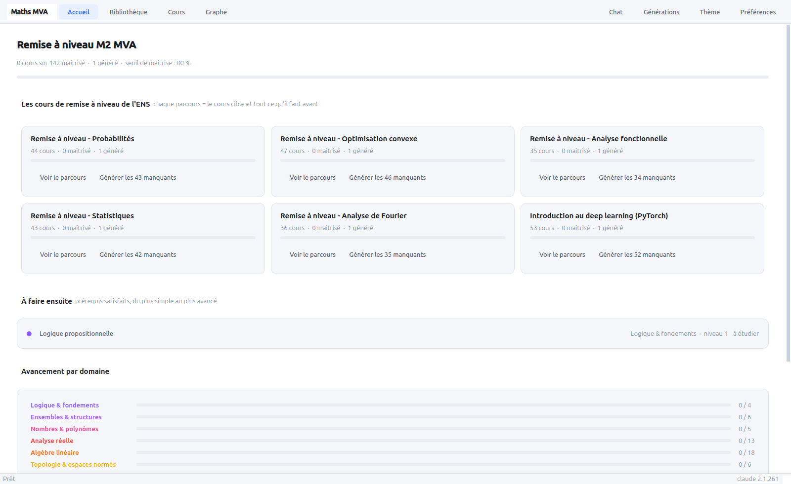
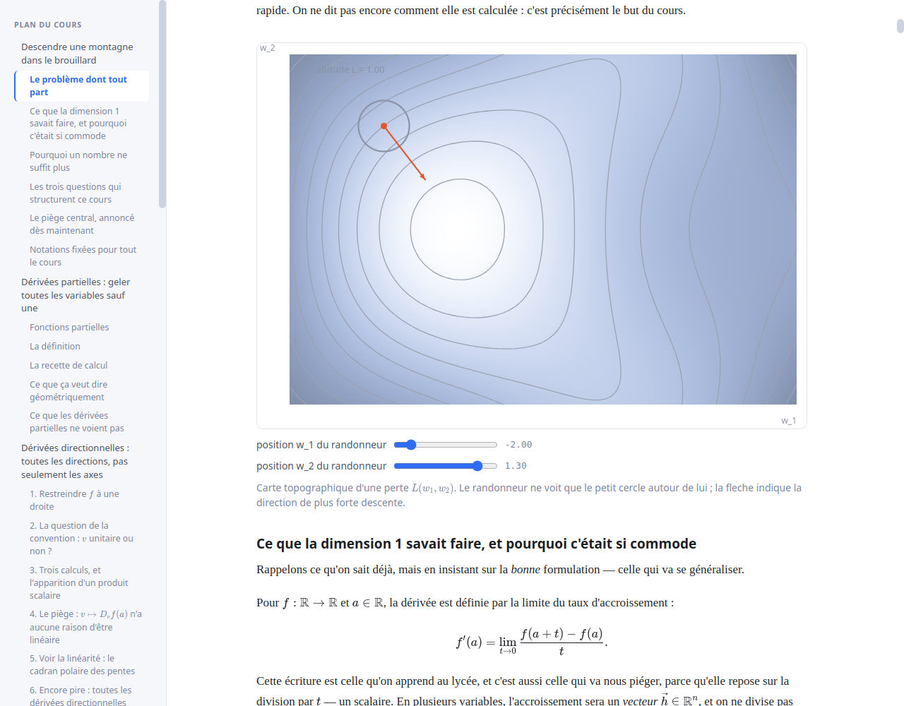
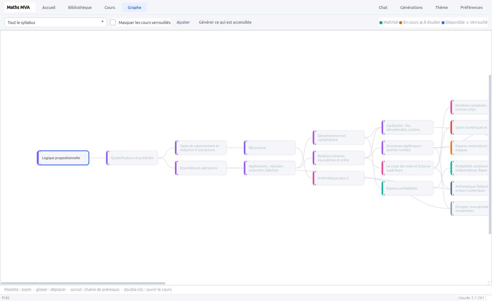
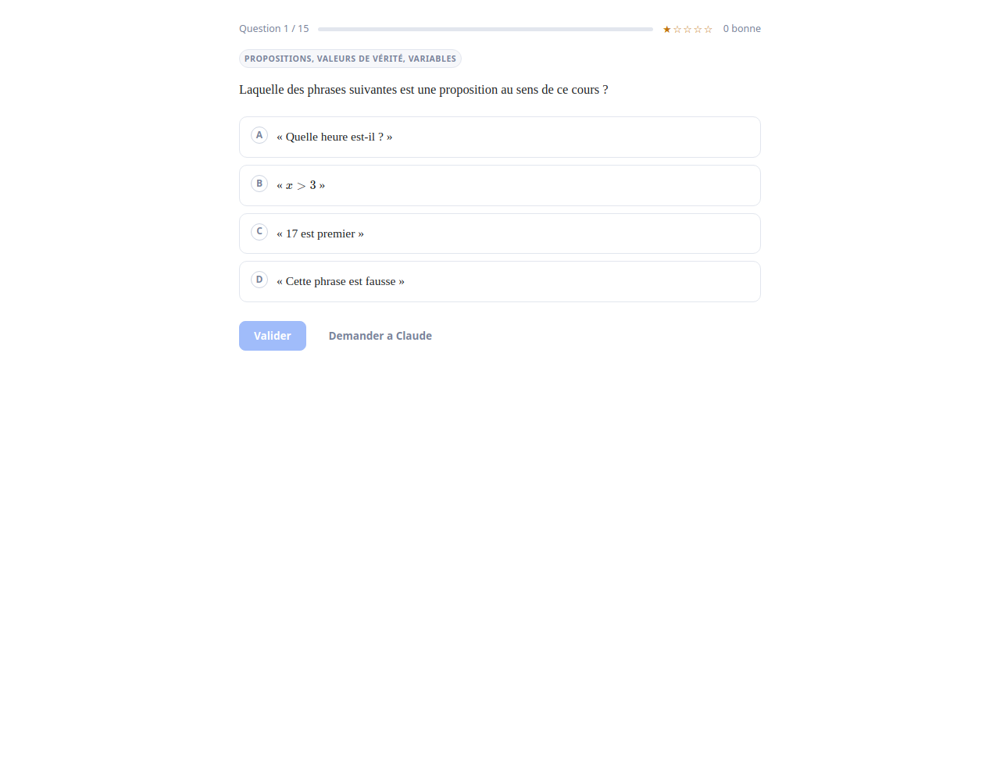
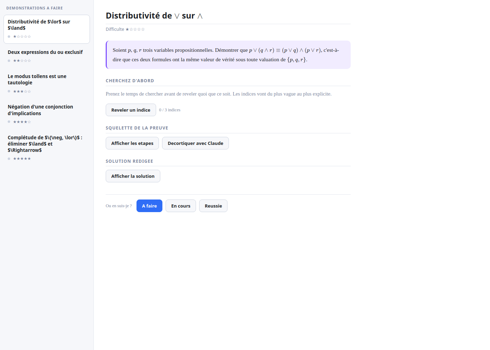
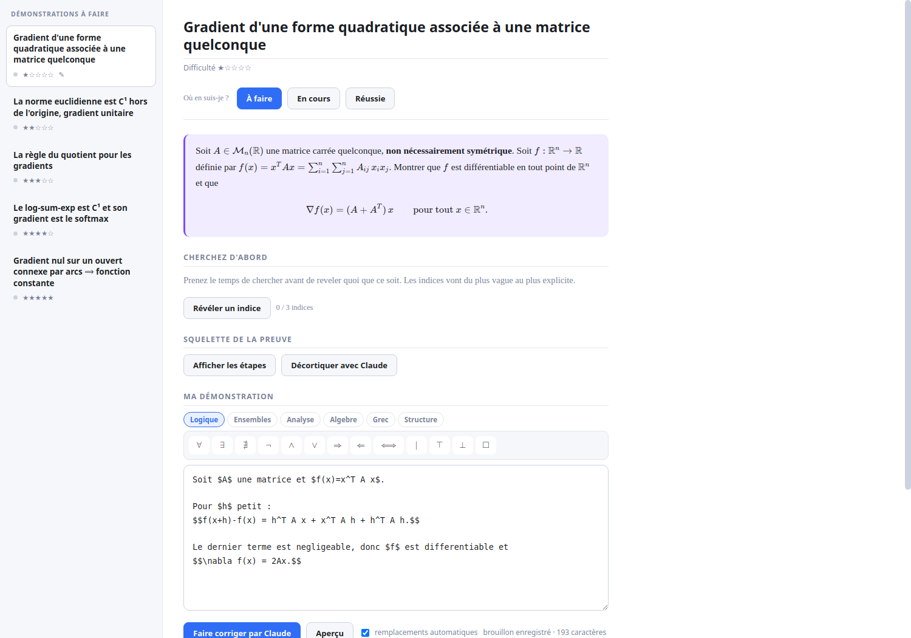
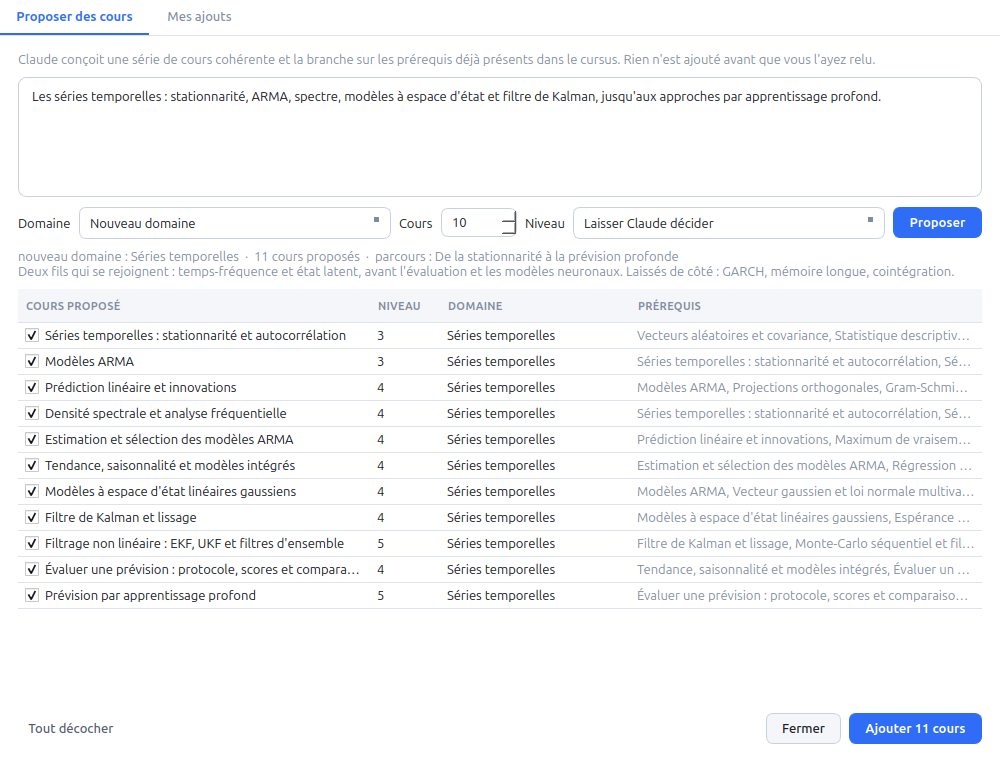
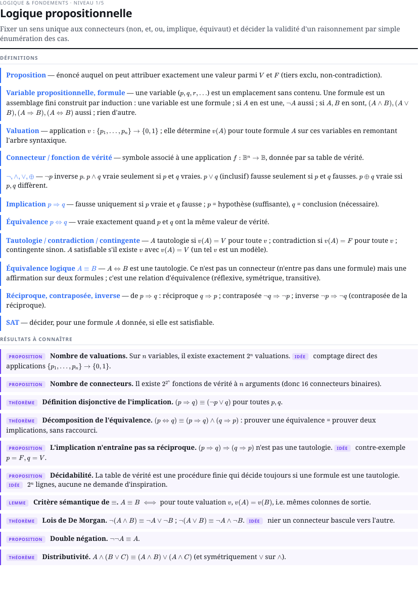

# Maths MVA

Application de bureau (Ubuntu, PySide6) pour reprendre les mathematiques de zero
et arriver pret aux cours de remise a niveau du M2 MVA.

Le principe : un syllabus complet de 142 cours, de la logique propositionnelle
aux modeles generatifs, relies par un graphe de prerequis. Chaque cours est
**genere a la demande par le `claude` installe localement** — cours redige,
figures interactives, demonstrations, QCM a difficulte croissante et
demonstrations a faire. Un chat Opus est disponible partout, y compris pour se
faire expliquer une demonstration etape par etape.

Tout est local : aucun serveur, aucun navigateur, KaTeX embarque.



<table>
<tr>
<td width="50%"></td>
<td width="50%"></td>
</tr>
<tr>
<td align="center"><em>Une figure de cours : carte topographique, lignes de niveau et
gradient, avec curseurs</em></td>
<td align="center"><em>Le cursus comme graphe : ce qui est accessible, ce qui est
verrouille</em></td>
</tr>
<tr>
<td></td>
<td></td>
</tr>
<tr>
<td align="center"><em>QCM a difficulte croissante</em></td>
<td align="center"><em>Demonstrations a faire, avec indices progressifs</em></td>
</tr>
</table>



<p align="center"><em>Rediger sa demonstration avec la palette de symboles, puis la
faire corriger par Claude</em></p>

---

## Installation

```bash
git clone git@github.com:Delata22/maths-mva.git
cd maths-mva
./run.sh
```

`run.sh` cree l'environnement virtuel et installe PySide6 au premier lancement.

Prerequis : Python 3.10+, et le CLI [`claude`](https://claude.com/claude-code)
authentifie (`claude auth`). L'application verifie sa presence au demarrage.

---

## Comment ca marche

### Le syllabus

262 cours repartis en 26 domaines, chacun avec ses prerequis, son niveau (1 a 5)
et ses objectifs. Le graphe de prerequis est verifie acyclique a la
construction, et les identifiants restent en ASCII (ils servent de noms de
dossiers).

Deux moities :

- **les mathematiques**, de la logique propositionnelle a l'analyse
  fonctionnelle, en passant par l'algebre lineaire, le calcul differentiel, la
  mesure, les probabilites, les statistiques, l'optimisation convexe et
  Fourier ;
- **l'apprentissage**, qui s'appuie dessus : fondements et evaluation, modeles
  classiques, theorie de l'apprentissage, bayesien et modeles graphiques,
  apprentissage profond, modeles generatifs, vision, langage et grands modeles,
  renforcement, transport optimal et donnees structurees, et la mise en
  pratique avec PyTorch.

Les **parcours** sont de deux familles :

- *les cours de la rentree* : les cinq remises a niveau de l'ENS et
  l'introduction au deep learning ;
- *les cours du M2* : vision, langage, renforcement, modeles generatifs,
  methodes a noyaux, modeles graphiques, graphes, transport optimal, fondements
  theoriques, apprentissage sequentiel, statistique computationnelle...

Un parcours regroupe le cours cible et l'integralite de ce qu'il faut savoir
avant : le parcours « Langage, parole et grands modeles » compte 114 cours, en
partant de la logique.

Le syllabus de base se modifie dans `tools/build_syllabus.py`, puis :

```bash
.venv/bin/python tools/build_syllabus.py
```

### Etendre le syllabus depuis l'application

Le bouton **Syllabus** (`Ctrl+N`) demande a Claude de concevoir une serie de
cours sur un sujet absent du cursus, et de la brancher sur les prerequis deja
presents.



Vous decrivez ce que vous voulez couvrir, choisissez un domaine existant ou
laissez-en creer un, et relisez la proposition avant qu'elle soit ajoutee :
chaque cours a sa case, ses prerequis resolus en clair, et le modele explique
ce qu'il a couvert et ce qu'il a laisse de cote. Rien n'entre dans le syllabus
sans validation.

La proposition est nettoyee avant d'etre presentee : identifiants recalcules
s'ils sont mal formes, doublons ecartes, prerequis inventes retires, cycles
refuses. Ce qui a ete corrige est affiche.

Vos ajouts vivent dans `library/syllabus_extra.json`, a cote de votre contenu,
et **survivent aux mises a jour du syllabus de base**. L'onglet *Mes ajouts*
les liste et permet de les retirer ; le contenu deja genere reste sur le disque
et sera reutilise si vous les recreez.

### La generation

Un cours est produit en trois temps, pour que chaque appel reste de taille
raisonnable et que la progression soit lisible :

1. **plan** — sections, figures prevues, resultats demontres, et une reserve de
   resultats volontairement laisses a demontrer en exercice ;
2. **sections** — chacune redigee separement, en connaissant le plan complet et
   ce qui precede ;
3. **exercices** — 15 QCM de difficulte 1 a 5 et 5 demonstrations a faire, en
   reprenant en priorite les resultats laisses de cote.

Le CLI tourne en `--safe-mode`, sans outils, dans un repertoire neutre : ni les
hooks, ni les `CLAUDE.md`, ni les reglages de projet de la machine n'influencent
le contenu genere.

Les modeles sont configurables (Preferences) : Opus pour les cours et le chat,
Sonnet pour les exercices par defaut.

**Ordre de grandeur.** Un cours complet fait 8 a 9 sections, soit environ
150 000 caracteres, une quinzaine de figures interactives et une trentaine de
resultats demontres. Comptez **15 a 20 minutes et 5 a 6 dollars** par cours avec
Opus. Generer les 142 cours du syllabus represente donc plusieurs jours de
calcul : mieux vaut generer parcours par parcours, ou au fil de l'eau.

Deux mecanismes rendent cela supportable :

- **les sections sont redigees en parallele** (3 par defaut, jusqu'a 6) ;
- **la generation est reprenable** : chaque section est ecrite dans son propre
  fichier, marque par une empreinte du plan. Une generation interrompue reprend
  ou elle s'etait arretee. Si le plan change, le cache est invalide.

### Le QCM : choisir ses questions, plusieurs series

L'onglet QCM s'ouvre sur la liste des questions plutot que sur la premiere
question. Chacune porte son resultat precedent — reussie, ratee, jamais faite —
et se coche individuellement. Trois raccourcis : *tout selectionner*,
*mes erreurs*, *jamais faites*. On refait donc les trois questions ratees sans
reprendre les quinze.

Une session portant sur une selection met a jour le suivi de chaque question,
mais ne compte pas comme un score du cours : refaire trois questions ratees ne
doit pas faire chuter la moyenne.

Le bouton **+ Nouvelle serie** demande une serie supplementaire : le modele
recoit les questions deja posees et doit couvrir en priorite ce qu'elles
laissent de cote. Les series s'empilent, chacune avec son propre suivi.

Certaines questions sont de vrais **exercices** : un enonce autosuffisant qu'on
ne resout pas de tete, ou les quatre propositions ne donnent que le resultat
final. Elles sont signalees, ouvrent un brouillon, et leurs propositions
restent masquees tant qu'on n'a pas cherche — sans quoi on remonte la solution
depuis les reponses. Un item marque exercice mais qui se resout en une ligne
est automatiquement requalifie en question directe : le badge doit vouloir dire
« prends une feuille ».

### L'equilibre des QCM

Un QCM ou la bonne reponse est plus longue et plus argumentee que les trois
autres se resout sans connaitre le cours. Sur les premiers cours produits, la
bonne reponse etait la plus longue 57 % du temps, et elle tombait en D une fois
sur cent cinquante.

Les consignes de generation imposent donc des propositions de longueur et de
registre comparables, et interdisent qu'une seule porte un raisonnement. Apres
generation, les questions ou la bonne reponse depasse encore les autres d'un
tiers sont renvoyees au modele pour reecriture, puis la position de la bonne
reponse est repartie sur les quatre lettres.

Pour reequilibrer des QCM deja produits :

```bash
python tools/fix_qcm.py --dry-run    # mesurer
python tools/fix_qcm.py              # corriger
```

### Ce qu'on attend d'un cours

Les prompts imposent une ligne editoriale precise : l'intuition avant le
formalisme, une figure interactive partout ou la geometrie eclaire l'algebre,
les demonstrations decoupees en etapes qui disent *pourquoi* avant *comment*,
et les pieges classiques nommes explicitement. Le niveau de depart suppose est
celui d'une terminale maths expertes.

### La fiche de revision

Chaque cours a deux formes : le cours long pour la premiere lecture, et une
**fiche condensee** pour y revenir. La fiche est produite a partir du cours
redige, dans l'onglet *Fiche* de la page de cours.



Elle contient les definitions et les enonces exacts avec leurs hypotheses, un
tableau de formules, les methodes formulees comme « pour montrer que..., faire
... », les pieges du cours, une liste de ce qu'il faut savoir refaire, et un
**rappel actif** : des questions dont la reponse est masquee a l'ecran et se
devoile au clic.

Elle est mise en page pour l'impression : deux a quatre pages A4, exportables
en PDF depuis l'onglet, ou en lot :

```bash
python tools/sheet_pdf.py --all --out ~/fiches
```

Les fiches des nouveaux cours sont produites automatiquement a la fin de leur
generation. Pour les cours deja rediges :

```bash
python tools/generate.py --sheets
```

### Les figures

Les cours utilisent `mviz`, une petite bibliotheque maison (aucune dependance) :
courbes, courbes parametrees, champs de vecteurs, lignes de niveau, cartes de
chaleur, curseurs et animations. Les couleurs suivent le theme clair/sombre.

---

## Utilisation

| Vue | A quoi ca sert |
|---|---|
| **Accueil** | Avancement global, les six parcours MVA, ce qu'on peut attaquer maintenant, ce qu'il faut reviser |
| **Bibliotheque** | Les 142 cours, filtrables par domaine, niveau, statut et parcours, avec le score de QCM |
| **Cours** | Lecture, fiche de revision, QCM, demonstrations, notes personnelles |
| **Graphe** | Le cursus comme graphe : ce qui est maitrise, ce qui est accessible, ce qui est verrouille |

Un cours passe **maitrise** quand le meilleur score de QCM atteint le seuil
(80 % par defaut), ce qui debloque les cours qui en dependent.

### Raccourcis

| | |
|---|---|
| `Ctrl+1..4` | Accueil / Bibliotheque / Cours / Graphe |
| `Ctrl+K` | Ouvrir le chat sur le cours courant |
| `Ctrl+F` | Rechercher un cours |
| `Ctrl+N` | Etendre le syllabus |
| `Ctrl+G` | Afficher la file de generation |

### Le chat

- **Panneau lateral** : questions libres, avec le contexte du cours ouvert et de
  ce qui a deja ete vu dans le cursus.
- **Selection dans un cours** : surligner un passage fait apparaitre
  « Demander a Claude », qui pre-remplit la question.
- **Demonstration pas a pas** : sur toute demonstration, du cours comme des
  exercices, « Decortiquer avec Claude » ouvre une fenetre dediee ou l'IA
  explique la logique de chaque etape, et ou l'on peut poser des questions.
- **Correction de sa propre demonstration** : voir ci-dessous.
- **Apres un QCM rate** : « Revoir mes erreurs avec Claude » envoie les
  questions manquees pour identifier la confusion de fond.

Chaque fil garde sa memoire entre les sessions.

### Rediger et faire corriger ses demonstrations

Chaque demonstration a faire dispose d'une zone de redaction, avec brouillon
enregistre automatiquement. Les mathematiques s'ecrivent en LaTeX entre `$ ... $`,
et trois choses evitent d'avoir a le taper a la main :

- une **palette de symboles** en six categories (logique, ensembles, analyse,
  algebre, grec, structures) qui insere au curseur ;
- des **raccourcis clavier** : `Alt+A` pour `\forall`, `Alt+E` pour `\exists`,
  `Alt+I` pour `\in`, `Alt+R` pour `\Rightarrow`, `Alt+Q` pour `\iff`,
  `Alt+G` pour `\nabla`, `Alt+F` pour `\frac`, `Alt+S` pour `\sum`,
  `Alt+T` pour `\int`, `Alt+L` pour `\lim`, `Alt+W` pour `\norm`,
  `Alt+M` pour entourer de `$…$` ;
- des **abreviations** developpees a l'espace : `=>`, `<=>`, `ssi`, `!=`, `>=`,
  `<=`, `->`, `|->`, `inf`, `qqs`, `ex`.

Un bouton *Apercu* rend le texte par KaTeX. **Faire corriger par Claude**
(ou `Ctrl+Entree`) ouvre une fenetre de correction : verdict, ce qui tient,
**le premier** point qui bloque avec une piste pour repartir, et les remarques
de redaction. La correction ne deroule pas la solution — sauf si vous la
demandez — et une preuve correcte differente de la solution de reference est
reconnue comme correcte. Vous corrigez, vous resoumettez : le fil garde les
versions precedentes et Claude dit si le point signale est regle.

---

## Savoir si ca genere ou si c'est plante

L'application montre en permanence, dans la barre de statut, un point de
couleur avec le nombre de generations et l'age du dernier signe de vie :

- **vert** : des donnees arrivent
- **orange** : plus rien depuis un moment, ce qui reste normal sur une section
  longue
- **rouge** : silence anormal ; un bandeau le signale, et l'appel sera
  interrompu puis relance tout seul

La file de generation (`Ctrl+G`) detaille la meme chose par cours : etape en
cours, nombre de caracteres deja recus, chronometre, et age du dernier signe de
vie. Cet affichage se met a jour toutes les deux secondes meme quand rien
n'arrive : c'est ce qui permet de distinguer *lent* de *bloque*.

Sous le capot, chaque appel est surveille : au-dela de quatre minutes de
silence complet (reglable dans les preferences), le processus et toute sa
descendance sont tues, l'echec est traite comme une panne reseau, et l'appel
est relance. Les sections deja ecrites ne sont jamais reperdues.

Depuis un terminal, meme pendant que l'application tourne :

```bash
python tools/status.py           # etat a l'instant t
python tools/status.py --watch   # rafraichi toutes les 5 s
```

Il liste les appels au modele en cours et sur quoi ils portent, la derniere
ecriture sur le disque, les cours incomplets, et termine par un verdict.

## Generation en ligne de commande

Pratique pour lancer un gros lot et laisser tourner :

```bash
python tools/generate.py al-svd cd-hessienne     # des cours precis
python tools/generate.py --path opt-dualite-kkt  # un cours et tous ses prerequis
python tools/generate.py --track mva-optimisation
python tools/generate.py --list
python tools/generate.py --resume                # reprendre ce qui a ete interrompu
```

## Outils de developpement

```bash
python tools/selftest.py           # verification de bout en bout, sans fenetre
python tools/selftest.py --chat    # ajoute un aller-retour reel avec Claude
python tools/shot.py al-svd                    # capture la page d'un cours
python tools/shot.py al-svd --view quiz        # ou son QCM
python tools/shot.py al-svd --anchor fig-svd   # cadre sur une figure
python tools/shot_app.py graphe /tmp/g.png     # capture une vue de l'app
python tools/install-desktop.sh                # entree dans le lanceur Ubuntu
```

---

## Ou vivent les donnees

```
library/
  <id-du-cours>/
    body.html        cours genere
    sheet.html       fiche de revision
    plan.json        plan et resultats laisses en exercice
    sections/        une section par fichier (reprise de generation)
    exercises.json   QCM et demonstrations (serie 1)
    quizzes.json     series de QCM supplementaires
    meta.json        modele, duree, cout
  progress.db        scores, statuts, notes, fils de discussion
```

`library/` n'est pas versionne : c'est votre progression et votre contenu. Pour
le sauvegarder, copiez ce dossier. Pour repartir de zero sur un cours,
clic droit > *Supprimer le contenu genere* (les scores sont conserves).

---

## Structure du code

```
mathsapp/
  syllabus.py        chargement du syllabus, graphe de prerequis
  syllabus_extra.py  ajouts faits depuis l'app : fusion, validation, retrait
  status.py          verrouille / disponible / a etudier / en cours / maitrise
  store.py           SQLite : scores, statuts, notes, discussions
  content.py         lecture des cours generes et assemblage des pages
  chat.py            conversation en streaming
  generation/
    claude_cli.py    appels au CLI claude
    prompts.py       ligne editoriale et format de sortie
    pipeline.py      plan -> sections -> exercices
    queue.py         file d'attente en arriere-plan
  ui/                fenetre principale et vues
  assets/            KaTeX, styles, mviz, pages QCM et demonstrations
tools/
  build_syllabus.py  source du syllabus
  generate.py        generation sans interface
  selftest.py        verification de bout en bout
  shot.py            capture d'une page de cours
  shot_app.py        capture d'une vue de l'application
```
